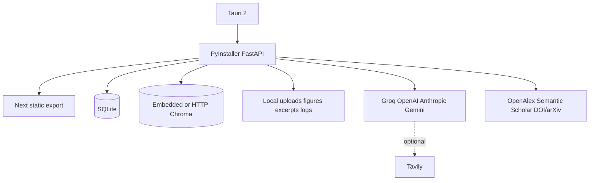

# ReSector project blueprint
**Status date:** November 7, 2026
**Desktop package configuration:** `0.2.1`
**Product state:** local-first desktop application with browser and Docker
development workflows

## Vision

ReSector is an AI research workstation for reading papers, testing claims, and
writing with traceable sources. It keeps the library and working state local,
lets the user choose the external AI provider, and makes unsupported answers
visible instead of hiding them behind fluent prose.

## Product surfaces

### Research dashboards

A dashboard is a project-specific canvas containing papers, saved text/area
excerpts, notes, claims, frames, comments, and links. Users can:

- upload or import papers and read them in the built-in PDF reader;
- highlight passages or regions and preserve page geometry;
- ask across all papers, selected papers, excerpts, or draft context;
- summarize papers and populate comparison rows;
- accept evidence-backed connections or inspect gap findings;
- write drafts with source markers, versions, checker feedback, and autopilot;
- export Markdown or print-ready HTML with numbered references.

### Paper Chat

Named sessions support multi-PDF upload, progress polling, session-scoped
retrieval, grounded answers, optional Tavily search, figure lookup, and
figure/vision analysis. Documents, messages, figures, vectors, and local files
can be removed with the session.

### Focused tools

- **Methodology Sifter** extracts research questions, methods, samples,
  findings, and limitations.
- **Adversarial Critique** supports five review personas, from supportive peer
  to Reviewer 2 and Devil's Advocate.
- **Jargon Simplifier** rewrites dense text with plain-language explanations
  and analogies.
- **Related papers** traverses citation/reference relationships using scholarly
  services and displays graph structure, communities, layouts, and exports.
- **Past results** searches the local research archive semantically.

## Runtime shape



The desktop shell tries `127.0.0.1:47821`, starts the sidecar with the
platform app-data directory, waits for startup and embedding warm-up, then
loads the frontend from the same local origin. If the preferred port is busy,
the shell selects a free fallback. `RESECTOR_DEV_URL` is available for UI-only
development.

## Data and privacy

Desktop data is stored at:

| Platform | Location |
|---|---|
| Windows | `%APPDATA%\com.resector.app` |
| macOS | `~/Library/Application Support/com.resector.app` |
| Linux | `~/.local/share/com.resector.app` |

Source development defaults to `user_data\`; Docker uses named volumes. The
data directory contains SQLite, Chroma, uploaded files, extracted figures,
excerpts, and logs. Provider keys are stored in webview/browser storage and
sent to the local backend per request; they are not stored in the database.
Only selected questions and retrieved passages are sent to external services.

## Repository map

| Area | Key files |
|---|---|
| API lifecycle and legacy routes | [`backend/main.py`](./backend/main.py) |
| Models and persistence | [`backend/database.py`](./backend/database.py) |
| Settings and paths | [`backend/config.py`](./backend/config.py) |
| Dashboard API | [`backend/dashboards.py`](./backend/dashboards.py) |
| Dashboard AI/wiring/drafts | [`backend/dashboards_ai.py`](./backend/dashboards_ai.py), [`backend/dashboards_wire.py`](./backend/dashboards_wire.py), [`backend/dashboards_drafts.py`](./backend/dashboards_drafts.py) |
| Processing and agents | [`backend/services/`](./backend/services/) |
| Workspace shell | [`frontend/src/app/page.tsx`](./frontend/src/app/page.tsx) |
| Paper Chat | [`frontend/src/app/paper-chat/page.tsx`](./frontend/src/app/paper-chat/page.tsx) |
| Dashboard UI | [`frontend/src/components/dashboard/`](./frontend/src/components/dashboard/) |
| API client and source markers | [`frontend/src/lib/dashboardApi.ts`](./frontend/src/lib/dashboardApi.ts), [`frontend/src/lib/drafts.ts`](./frontend/src/lib/drafts.ts) |
| Desktop lifecycle | [`desktop/src-tauri/src/main.rs`](./desktop/src-tauri/src/main.rs) |
| Packaging | [`desktop/scripts/`](./desktop/scripts/), [`desktop/src-tauri/tauri.conf.json`](./desktop/src-tauri/tauri.conf.json) |

## Build and validation

### Desktop

```powershell
python -m venv .venv-desktop
.\.venv-desktop\Scripts\Activate.ps1
pip install -r desktop\sidecar\requirements-desktop.txt
python desktop\scripts\build_backend.py
Set-Location desktop
npm install
npm run build:frontend
npm run tauri build
```

The shortcut is `Set-Location desktop; npm run package`. Bundles are emitted
under `desktop\src-tauri\target\release\bundle\`.

### Browser/Docker

```powershell
.\.venv\Scripts\python.exe -m pip install -r backend\requirements.txt
.\.venv\Scripts\python.exe -m uvicorn backend.main:app --reload --port 8000

Set-Location frontend
npm install
npm run dev
npm run lint
npx tsc --noEmit
```

```powershell
docker compose up --build
```

The Docker UI is `http://localhost:3000`; the API is
`http://localhost:8000`. Use `docker compose stop` or `down` to preserve data.
`down -v` is destructive and must not be used casually.

## Current limitations

- The desktop updater and bundle are configured for the current Tauri package;
  release artifacts still depend on the target operating system and signing
  setup.
- API keys are not in the OS keychain.
- External providers, Tavily, and scholarly services require network access
  and valid credentials where applicable.
- First launch may be slow while the embedding model initializes.
- SQLite schema setup is additive only; there is no migration framework.
- AI output remains an aid for research and writing and requires human review.
