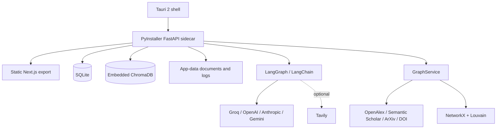

# ReSector: Project Blueprint

## Current release status

**Status date:** October 21, 2026
**Release:** [`v0.1.0-beta.1`](https://github.com/Shreyas8905/resector/releases/tag/v0.1.0-beta.1)
**Product state:** First public desktop beta

ReSector has moved from a browser-first research workspace to a distributable
desktop application. The beta is packaged for Windows x64 as
`ReSector_0.1.0_x64-setup.exe`. The application is functional end to end, but
it is still a beta release: installers are unsigned, macOS/Linux artifacts are
not published, and users should report defects through GitHub Issues.

The desktop product bundles a Tauri 2 shell, a PyInstaller-frozen FastAPI
backend, and a static export of the Next.js frontend. The backend runs locally
on `127.0.0.1`, uses SQLite and embedded ChromaDB by default, and writes data
to the platform app-data directory. Provider APIs remain optional and require
the user's own credentials.

## Product goals

- Give researchers one focused workspace for paper discovery, document
  understanding, and claim evaluation.
- Keep documents, indexes, sessions, and logs local by default.
- Make external model/search calls explicit, configurable, and bounded.
- Produce research outputs that distinguish local evidence from web evidence.
- Turn citation relationships into an explorable, exportable literature map.

## Current capabilities

### 1. Desktop application

- Tauri 2 native window with a startup splash and backend readiness check.
- PyInstaller sidecar starts the FastAPI service without a separate Python
  installation for end users.
- Preferred local origin `http://127.0.0.1:47821`; random fallback only when the
  preferred port is unavailable.
- Same-origin frontend/backend in packaged builds; no API URL is baked into the
  desktop frontend.
- Backend logs are written to `<app-data>\logs\backend.log`.
- Clean sidecar shutdown when the desktop window exits.
- Windows x64 installer published in the beta release.

### 2. Paper chat and RAG

- Named research sessions with cascading message/document cleanup.
- Batch PDF upload, text extraction, chunking, embedding, and progress polling.
- Session-scoped ChromaDB retrieval for grounded answers.
- LangGraph ReAct workflow with local retrieval and optional Tavily search.
- Delete individual documents and remove their ChromaDB chunks and local files.
- Delete sessions, clear history, delete individual messages, and copy
  Markdown responses.
- Starter cards for findings, methods, comparisons, and future work.
- Citation graph toggle connected to the paper-chat experience.

### 3. Academic analysis tools

- **Methodology Sifter:** research questions, methodology, sample size,
  findings/metrics, and fatal flaws or limitations.
- **Adversarial Critique:** Supportive Peer, Constructive Colleague, Rigorous
  Scholar, Brutal Reviewer #2, and Devil's Advocate personas.
- **Jargon Simplifier:** plain-English breakdowns and memorable analogies.
- All three tools accept pasted text and PDF/TXT/Markdown uploads.
- Long documents use reference-section stripping, bounded recursive chunking,
  map/merge condensation, provider-specific budgets, and maximum-part guards.
- Optional Tavily search uses a bounded call budget, focused queries, duplicate
  URL removal, and numbered source reconciliation.
- Oversized search-enabled requests retry once without web search and expose an
  explicit note rather than silently pretending web evidence was used.

### 4. Citation graph

- Multi-hop paper traversal through OpenAlex and Semantic Scholar.
- ArXiv/DOI matching and Tavily scholarly fallback.
- Citation, reference, cross-citation, and bibliographic-coupling edges.
- Up to 50-paper graph view with shortest-path proximity and importance scores.
- Louvain community detection with 4-8 thematic cluster colors.
- Force Atlas, Clusters, and Years layouts.
- Title-density and importance controls, simulation reheating, recentering, and
  GEXF export.

### 5. Archive and settings

- Local semantic search over prior research logs.
- Chronological archive browsing and filtering.
- Provider selection for Groq, OpenAI, Anthropic, and Google Gemini.
- Optional Tavily API-key validation.
- SSR-safe theme switching and guarded persisted configuration parsing.

## Runtime architecture



### Desktop startup sequence

1. Tauri loads the splash page.
2. The shell selects port `47821`, or a free local fallback.
3. The bundled `resector-backend` sidecar receives `RESECTOR_PORT`,
   `DATA_DIR`, and `FRONTEND_DIR`.
4. The shell waits for the backend socket to become ready, including startup
   initialization and embedding-model warm-up.
5. The webview navigates to the local backend, which serves the exported UI.
6. On exit, the shell terminates the sidecar.

### Data storage

| Data | Desktop location |
| --- | --- |
| SQLite database, uploads, ChromaDB, logs | Windows `%APPDATA%\com.resector.app` |
| SQLite database, uploads, ChromaDB, logs | macOS `~/Library/Application Support/com.resector.app` |
| SQLite database, uploads, ChromaDB, logs | Linux `~/.local/share/com.resector.app` |

The default web development path uses `user_data\resector.db` and
`user_data\chroma`. Docker maps those resources to persistent volumes and runs
ChromaDB as a separate service.

## Repository map

### Desktop

- `desktop/package.json`: desktop build, development, and packaging scripts.
- `desktop/scripts/build-frontend.mjs`: builds the frontend in static-export
  mode with same-origin API configuration.
- `desktop/scripts/build_backend.py`: freezes the backend with PyInstaller.
- `desktop/sidecar/entry.py`: packaged backend entry point and log setup.
- `desktop/sidecar/resector_backend.spec`: PyInstaller bundle definition.
- `desktop/sidecar/requirements-desktop.txt`: runtime dependencies for the
  frozen backend.
- `desktop/src-tauri/src/main.rs`: Tauri lifecycle, port selection, sidecar
  startup, readiness polling, error display, and shutdown.
- `desktop/src-tauri/tauri.conf.json`: app identity, window, resources, icons,
  and bundle targets.
- `desktop/splash/index.html`: startup and backend-error screen.

### Backend

- `backend/main.py`: FastAPI lifecycle, CORS, validation, text/document tool
  endpoints, chat/session endpoints, upload processing, archive search, and
  graph routes.
- `backend/config.py`: environment settings, data directories, SQLite default,
  ChromaDB mode/path, embedding model, and document-analysis limits.
- `backend/database.py`: SQLAlchemy models, SQLite WAL/foreign-key setup, and
  embedded/HTTP ChromaDB client initialization.
- `backend/provider_factory.py`: provider adapters and API-key validation.
- `backend/tools.py`: Sifter, Critique, Jargon, bounded search, long-document
  condensation, retries, and source validation.
- `backend/services/pdf_processor.py`: asynchronous PDF extraction, chunking,
  embedding, ChromaDB indexing, and document status updates.
- `backend/services/rag_agent.py`: grounded paper-chat agent and local/web
  retrieval tools.
- `backend/services/graph_service.py`: scholarly paper resolution, graph
  traversal, coupling, citations, Louvain clusters, and exports.

### Frontend

- `frontend/src/app/page.tsx`: main workspace and tool switcher.
- `frontend/src/app/paper-chat/page.tsx`: paper-chat sessions, upload polling,
  starter prompts, and graph integration.
- `frontend/src/components/PaperGraphView.tsx`: interactive graph canvas.
- `frontend/src/components/SifterTool.tsx`: methodology analysis UI.
- `frontend/src/components/CritiqueTool.tsx`: persona critique UI.
- `frontend/src/components/JargonTool.tsx`: jargon translation UI.
- `frontend/src/components/DocumentPicker.tsx`: shared PDF/TXT/MD picker.
- `frontend/src/components/SettingsDrawer.tsx`: provider and Tavily settings.
- `frontend/src/components/ResearchHistory.tsx`: archive search and results.
- `frontend/src/lib/documentApi.ts`: multipart document upload client.
- `frontend/next.config.ts`: desktop static-export switch controlled by
  `DESKTOP_BUILD=1`.

### Deployment

- `Dockerfile`: backend/ChromaDB image.
- `docker-compose.yml`: ChromaDB, backend, and frontend services.
- `SETUP.md`: browser/Docker development instructions.

## Build and validation

### Desktop packaging

```powershell
python -m venv .venv-desktop
.\.venv-desktop\Scripts\Activate.ps1
pip install -r desktop\sidecar\requirements-desktop.txt
python desktop\scripts\build_backend.py
Set-Location desktop
npm install
npm run build:frontend
npm run tauri build
```

### Web development

```bash
cd backend && pip install -r requirements.txt
uvicorn backend.main:app --reload --port 8000

cd frontend && npm install && npm run dev
```

### Known beta limitations

- Only the Windows x64 installer is currently published.
- Installers are unsigned and may trigger OS security warnings.
- API keys currently live in webview local storage; OS keychain integration is
  not yet implemented.
- First launch can take longer while the embedding model initializes.
- External providers and scholarly APIs require network access and valid keys
  where applicable.
