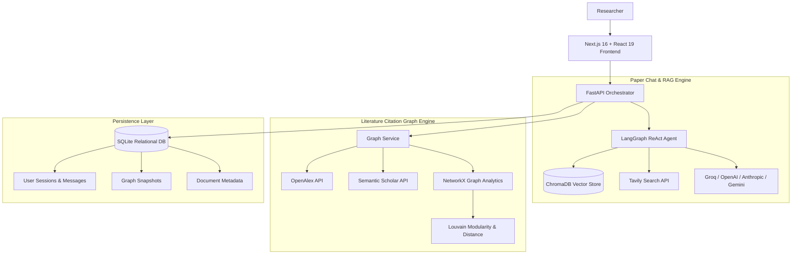

# Resector: Local-First Academic Research Companion

Resector is an advanced, local-first research workstation engineered to transform how researchers interact with scientific literature, citations, and the web. By combining a decoupled Frontend/Backend architecture with agentic RAG (Retrieval-Augmented Generation), recursive citation graph modeling, and customizable AI personas, Resector enables researchers to conduct rigorous deep-dive investigations with high precision, grounded inline citations, and visual literature cartography.

## 📌 Current Project Status

**Status date: October 18, 2026**

The current branch contains the working research workspace, including the citation
graph, grounded paper chat, research archive, and all three academic analysis
tools. The latest work focused on making document analysis practical and
source-aware:

- PDF, TXT, and Markdown uploads are supported by the Sifter, Critique, and
  Jargon tools, with a shared document picker and multipart upload endpoint.
- Large documents are processed with reference-section removal, bounded
  chunking, map/merge condensation, provider-aware character budgets, and an
  explicit maximum-part guard.
- Optional Tavily search is available to all three tools. Search calls are
  capped per provider, duplicate URLs are de-duplicated, and model-generated
  inline source numbers are reconciled with a validated source list.
- Oversized provider requests fall back to a no-search run with an explicit
  user-facing note; rate-limit retries remain limited to retryable errors.
- Document deletion now removes both the relational record and its associated
  ChromaDB chunks.
- The default local persistence path is SQLite under `user_data/`, while
  ChromaDB can run embedded or as the Compose `chroma` service.
- Docker Compose now runs separate `chroma`, `backend`, and `frontend` services
  with persistent volumes and health checks. The previous all-in-one image and
  PostgreSQL-first documentation are no longer the current deployment model.

---

## 🚀 Key Features

### 1. 50-Paper Recursive Citation Network & Community Graph
- **Multi-Source Academic Traversal**: Queries OpenAlex (250M+ scholarly works) and Semantic Scholar API with ArXiv/DOI matching and Tavily scholarly web fallback to reliably aggregate 50–60 connected peer-reviewed papers.
- **Bibliographic Coupling & Cross-Citations**: Detects shared references (Jaccard similarity ≥ 0.035) and cross-citations across all candidate works, generating 800+ interconnected chain links rather than isolated star graphs.
- **Louvain Modularity Clustering**: Automatically partitions citation networks into 4–8 distinct thematic communities, assigning distinct vibrant color palettes (Orange, Green, Purple, Blue, Red, Brown, Yellow, Teal).
- **Proximity Distance & Importance Metrics**: Root paper pinning, multi-hop shortest path graph distances, and normalized citation/reference importance scores.
- **Interactive D3 Physics Canvas**: Real-time `Titles` density threshold slider, `Importance` size scaling with live D3 reheat simulation, layout presets (`Force Atlas`, `Clusters`, `Years`), and `Export GEXF` for Gephi analysis.

### 2. Immersive Paper Chat & Grounded RAG Agent
- **Multi-Document PDF Indexing**: Upload and batch process multiple scientific PDFs with PyMuPDF text chunking, local vector embedding, and session-scoped ChromaDB collections.
- **LangGraph ReAct Agent Loop**: Iteratively reasons whether to query local paper vectors or search the live web via Tavily for contemporary verification.
- **Complete Conversation Lifecycle**: Create named research sessions, delete entire sessions with cascading file cleanup, clear chat history, delete single messages, copy markdown outputs, and filter session history.
- **Starter Analytical Prompts**: Instant 1-click queries for core finding synthesis, methodological critiques, metric comparisons, and future work extraction.
- **Isolated Viewport Layout**: Pinned header and footer input bar with independently scrolling conversation feed.

### 3. Core Academic Analysis Tools
- **Methodology Sifter**: Structured extraction pipeline extracting core research questions, sample sizes, experimental setups, and fatal methodological flaws from pasted text or uploaded documents.
- **Persona Spectrum (Critique Tool)**: 5-stage critical tone spectrum—from Supportive Peer to Hostile Reviewer 2.
- **Jargon Simplifier**: Layered technical translation bridging dense mathematical and scientific terminology to intuitive analogies.
- **Shared document workflow**: All three tools accept PDF, TXT, and Markdown uploads, including long-document chunking and optional web verification.
- **Research Archive**: Chronological search, tag filtering, and inspection of past analytical queries.

---

## 🏗️ Architecture & Data Flow



---

## 🐳 Deployment

Resector uses Docker Compose with separate `chroma`, `backend`, and `frontend`
services. SQLite, uploaded documents, ChromaDB data, and the embedding-model
cache are persisted in named volumes.

```bash
docker-compose up --build
# Frontend: http://localhost:3000
# Backend:  http://localhost:8000
```

For local development without Docker (running each service separately), see [SETUP.md](./SETUP.md).

---

## 📂 File Directory & Purpose

### 📁 Root
- `docker-compose.yml`: Compose orchestration for ChromaDB, the FastAPI backend, and the Next.js frontend.
- `Dockerfile`: Backend image used by the API and ChromaDB services.
- `.dockerignore`: Build optimization to exclude unnecessary files.
- `CLAUDE.md`: AI assistant operational manual and quick commands.
- `PROJECT.md`: Comprehensive project blueprint, architecture, and feature index.
- `README.md`: Public-facing engineering documentation and architecture diagrams.
- `SETUP.md`: Detailed environment configuration and onboarding instructions.

### 📁 backend/
- `main.py`: FastAPI server with Depends-based DB session management, lifespan initialization, explicit CORS origins, structured logging, text/document tool processing, chat sessions, document lifecycle, and graph endpoints.
- `config.py`: Centralized environment configurations with env var priority and rate limit error handlers.
- `database.py`: SQLAlchemy 2.0 ORM models (`UserSession`, `ChatMessage`, `Document`, `ResearchLog`, `GraphSnapshot`) backed by SQLite with WAL/foreign-key pragmas, cascade relationships, and thread-safe embedded/HTTP ChromaDB initialization.
- `provider_factory.py`: Pluggable LLM factory supporting Groq, OpenAI, Anthropic, and Google Gemini with Pydantic API key validation.
- `tools.py`: Academic research tools (Sifter, Critique, Jargon), provider-aware retries, long-document condensation, bounded Tavily search, and validated inline source handling.
- `requirements.txt`: Python package specifications.
- **📁 services/**
  - `graph_service.py`: High-throughput citation engine (OpenAlex, Semantic Scholar, NetworkX, Louvain clustering, Bibliographic coupling) with structured logging and stable hashing.
  - `rag_agent.py`: LangGraph ReAct agent loop with enum-based role comparison for chat history and retryable-error-only retry logic.
  - `pdf_processor.py`: Async-safe PDF extraction (run_in_executor), semantic chunking, ChromaDB vector indexing, and corrupt/password-protected PDF handling.

### 📁 frontend/
- `package.json`: Next.js 16, React 19, Tailwind CSS 4, Lucide icons, `react-markdown`, and `react-force-graph-2d`.
- **📁 src/app/**
  - `page.tsx`: Main workspace container with fixed viewport, sidebar switcher, and theme provider.
  - `layout.tsx`: Root HTML layout.
  - `globals.css`: Academic high-contrast design system and CSS variables.
  - **📁 paper-chat/**
    - `page.tsx`: Immersive paper chat interface, starter prompt cards, session management, proper interval cleanup, and 50-Paper network integration.
- **📁 src/components/**
  - `PaperGraphView.tsx`: Interactive 50-Paper citation graph canvas with D3 physics reheat, Louvain community clusters, titles/importance sliders, and GEXF export.
  - `SifterTool.tsx`: UI for structured research methodology extraction from pasted text or an uploaded PDF/TXT/MD document.
  - `CritiqueTool.tsx`: UI for the 5-stage Persona Spectrum academic critique with text/document input and API key pre-validation.
  - `JargonTool.tsx`: UI for technical jargon translation with text/document input and API key pre-validation.
  - `DocumentPicker.tsx`: Shared document selection control used by all three analysis tools.
  - `ToolUI.tsx`: Shared tool layout, input, loading, and Markdown output components.
  - `ResearchHistory.tsx`: Historical query archive using GET endpoint with query params and error states.
  - `SettingsDrawer.tsx`: User API key vault with guarded JSON.parse, Escape key close, and backdrop click-to-close.
  - `ThemeToggle.tsx`: Synchronized Dark/Light mode switcher with SSR-safe mounting.
  - `../lib/documentApi.ts`: Multipart document upload client and persisted provider/Tavily configuration reader.
