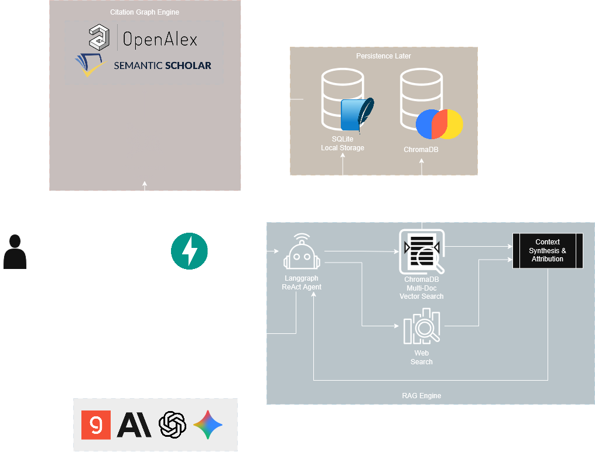
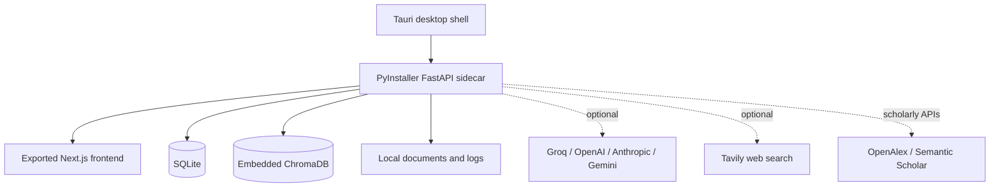

<div align="center">
  

  <h1 style="border-bottom: none;">ReSector</h1>

  <p>
    An AI-powered research workstation for intelligent literature exploration,
    evidence synthesis, and scientific discovery.
  </p>
</div>

<div align="center">

[](https://github.com/Shreyas8905/resector/releases)
[](https://github.com/Shreyas8905/resector/releases/tag/v0.1.0-beta.1)

</div>

ReSector brings grounded paper chat, document analysis, web-assisted research
tools, and interactive citation mapping into a local-first research workspace.
The web application is the foundational architecture; the desktop application
packages that same FastAPI backend and Next.js interface for a native local
experience. Research documents and application data stay on the local machine
by default; external LLM and search providers are used only when configured by
the researcher.

> **Current release:** `v0.1.0-beta.1`
> The first public desktop beta is available for Windows x64. It may contain
> bugs; please [report problems in GitHub Issues](https://github.com/Shreyas8905/resector/issues).

## Choose a version

ReSector is available in three deployment modes:

| Version | Best for | Start here |
| --- | --- | --- |
| **Desktop beta** | End users who want a native local app | Download the Windows installer below |
| **Web with Docker** | Reproducible local deployment | `docker compose up --build` |
| **Web without Docker** | Developers running backend and frontend separately | Follow the [SETUP.md](./SETUP.md) local-development guide |

All three versions use the same research workspace and support provider
configuration from the **Settings** drawer. The desktop version bundles the
backend; the two web versions run it as a separate service.

## Quick start

### Desktop beta

Download the Windows installer from the
[ReSector 0.1.0 beta 1 release](https://github.com/Shreyas8905/resector/releases/tag/v0.1.0-beta.1):

- **Windows x64:** `ReSector_0.1.0_x64-setup.exe`

The current installer is unsigned, so Windows SmartScreen may display a
warning. Review the release page and proceed only if you trust the downloaded
artifact. macOS and Linux packaging is planned but is not included in this
release.

After launching the app, open **Settings**, choose an LLM provider, enter its
API key, optionally add Tavily and Semantic Scholar keys, test the keys, and
click **Apply Configuration**. See [SETUP.md](./SETUP.md) for provider-key
details and the web setup instructions.

### Web with Docker

```bash
docker compose up --build
```

Open `http://localhost:3000`, then configure API keys from **Settings**. The
API runs at `http://localhost:8000`.

### Web without Docker

Start the FastAPI backend and Next.js frontend in separate terminals, then open
`http://localhost:3000` and configure keys from **Settings**:

```bash
uvicorn backend.main:app --reload --port 8000
cd frontend && npm install && npm run dev
```

For prerequisites, environment options, troubleshooting, and the full desktop
build procedure, see [SETUP.md](./SETUP.md).

## What you can do

### Grounded paper chat

- Create separate research sessions.
- Upload and index multiple PDFs for a session.
- Ask questions against the local ChromaDB vector index.
- Use LangGraph's ReAct workflow to combine paper retrieval with optional
  Tavily web search.
- Track document processing progress and remove documents cleanly.
- Delete sessions, messages, or chat history; copy Markdown responses.
- Start common analyses from built-in prompt cards.

### Academic analysis tools

- **Methodology Sifter:** extract research questions, methods, samples,
  findings, and limitations.
- **Adversarial Critique:** stress-test a claim using five reviewer personas,
  from Supportive Peer to Reviewer #2 and Devil's Advocate.
- **Jargon Simplifier:** translate technical writing into plain English and
  useful real-world analogies.
- Paste text or upload PDF, TXT, and Markdown documents to any tool.
- Process long documents through reference stripping, bounded chunking,
  condensation, and provider-aware limits.
- Optionally verify claims with bounded Tavily search and receive de-duplicated,
  numbered sources.

### Citation graph

- Traverse related literature through OpenAlex and Semantic Scholar, with
  ArXiv/DOI resolution and scholarly web fallback.
- Explore up to 50 connected papers with citation, reference, cross-citation,
  and bibliographic-coupling links.
- Inspect Louvain communities, node importance, shortest-path proximity, and
  paper metadata.
- Switch between Force Atlas, Clusters, and Years layouts.
- Filter title density, scale nodes by importance, recenter the graph, and
  export GEXF for Gephi.

### Research archive

Search previous analyses using the local semantic archive and inspect earlier
research interactions.

## Web architecture

The web application is the base architecture for ReSector. It uses a decoupled
Next.js frontend and FastAPI orchestration layer, with local persistence and
specialized research services behind the API. The complete system design is
shown in [`arch.png`](./arch.png):



The main web data flow is:

1. The **Next.js client** sends research requests to the **FastAPI
   orchestrator**.
2. The orchestrator routes requests to the **LangGraph ReAct agent**, document
   processing pipeline, or citation graph service.
3. The RAG engine combines **ChromaDB multi-document retrieval** with optional
   **Tavily web search**, then synthesizes grounded context.
4. The **LLM provider factory** connects to the configured Groq, OpenAI,
   Anthropic, or Google Gemini provider.
5. **SQLite** stores sessions, messages, documents, research logs, and graph
   snapshots; **ChromaDB** stores local vector embeddings.
6. The citation graph service queries **OpenAlex** and **Semantic Scholar**, with
   ArXiv/DOI resolution and scholarly search fallback.

This web architecture is available in two forms:

- **Web with Docker:** Compose runs separate ChromaDB, FastAPI, and Next.js
  services.
- **Web without Docker:** the same backend and frontend run directly as local
  development processes, using embedded ChromaDB by default.

## Desktop architecture

The released desktop app is a Tauri 2 shell around the web architecture above.
It contains:

1. **Tauri native shell** - starts and stops the local backend and hosts the
   application window.
2. **PyInstaller backend sidecar** - runs FastAPI, SQLite, ChromaDB, document
   processing, provider adapters, and research services.
3. **Exported Next.js frontend** - served by the local backend from the same
   origin.

In other words, the desktop version does not introduce a separate research
engine: it bundles the web frontend and backend into a native local
distribution. The web architecture remains the source of the application's
runtime behavior and feature set.



The shell uses `127.0.0.1` only and prefers port `47821`; it chooses another
local port if that port is occupied. A stable preferred origin keeps settings
in the webview's local storage across launches.

## Local data and privacy

The desktop app stores its SQLite database, uploaded files, ChromaDB data,
embedding cache, and logs in the OS application-data directory:

| Platform | Data directory                                   |
| -------- | ------------------------------------------------ |
| Windows  | `%APPDATA%\com.resector.app`                     |
| macOS    | `~/Library/Application Support/com.resector.app` |
| Linux    | `~/.local/share/com.resector.app`                |

Uninstalling or updating the application does not intentionally remove this
directory. API keys are entered per user and kept in the webview's local
storage for the current app origin. Moving credentials to the OS keychain is a
planned improvement. Do not put personal keys in the repository or bundle
`backend/.env` into a release.

## Build from source

### Desktop prerequisites

- Node.js 20+
- Python 3.12
- Rust via [rustup](https://rustup.rs)
- Windows: Microsoft C++ Build Tools and WebView2
- Linux: Tauri system libraries such as `webkit2gtk`

Build on the operating system for which the installer is intended.

```powershell
# From the repository root, Windows
python -m venv .venv-desktop
.\.venv-desktop\Scripts\Activate.ps1
pip install -r desktop\sidecar\requirements-desktop.txt
python desktop\scripts\build_backend.py

Set-Location desktop
npm install
npm run build:frontend
npm run tauri build
```

The installer is produced under
`desktop\src-tauri\target\release\bundle\`. To run all build steps through the
desktop package script:

```powershell
Set-Location desktop
npm run package
```

### Desktop development

For a complete desktop development run:

```powershell
Set-Location desktop
npm run dev
```

To develop only the UI against the normal frontend dev server:

```powershell
Set-Location frontend
npm run dev

# In another terminal
$env:RESECTOR_DEV_URL = "http://localhost:3000"
Set-Location desktop
npm run dev
```

## Technology

- Tauri 2 and Rust
- FastAPI, Uvicorn, SQLAlchemy, and SQLite
- ChromaDB with `all-MiniLM-L6-v2` embeddings
- LangChain and LangGraph
- Next.js 16, React 19, Tailwind CSS 4
- NetworkX and Louvain community analysis
- OpenAlex, Semantic Scholar, ArXiv/DOI resolution, and optional Tavily

## Project documentation

- [PROJECT.md](./PROJECT.md) - current product status, architecture, and
  component inventory
- [CLAUDE.md](./CLAUDE.md) - build commands and repository guidance for coding
  assistants
- [SETUP.md](./SETUP.md) - browser/Docker development setup
- [GitHub Releases](https://github.com/Shreyas8905/resector/releases) -
  installers and release notes

## License

See the repository license and third-party dependency notices before
redistributing builds.
