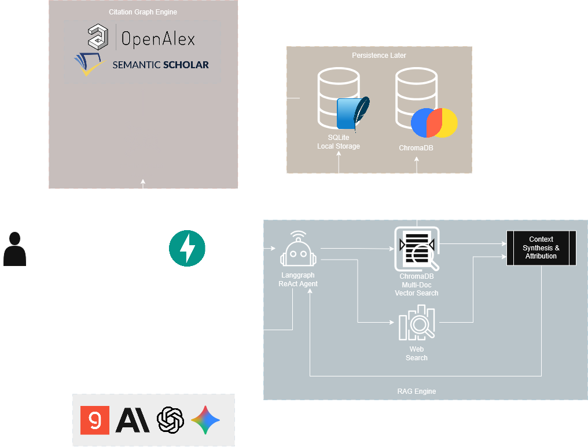

# ReSector technical documentation
This document describes the implementation currently in the repository. See
[SETUP.md](./SETUP.md) for installation and [README.md](./README.md) for the
user-facing overview.

## 1. Runtime architecture



```text
Tauri 2 shell
  -> PyInstaller resector-backend sidecar
      -> FastAPI application
          -> exported Next.js UI (desktop) or separate Next.js dev server
          -> SQLite + ChromaDB + local documents
          -> optional LLM, Tavily, and scholarly services
```

| Layer | Implementation |
|---|---|
| UI | Next.js 16, React 19, Tailwind 4, React Flow, PDF.js, React Markdown |
| API | FastAPI, Pydantic, SQLAlchemy 2 |
| Relational store | SQLite by default; WAL, foreign keys, busy timeout |
| Vector store | ChromaDB embedded `PersistentClient`, or HTTP mode |
| Embeddings | bundled/downloaded `all-MiniLM-L6-v2` |
| PDF/figures | PyMuPDF extraction, page geometry, crops, optional vision |
| Agents | LangChain/LangGraph provider adapters and bounded tool calls |
| Desktop | Tauri 2, Rust lifecycle, PyInstaller sidecar, updater |

Desktop uses one origin: the sidecar serves the exported UI and API. Web and
Docker use `NEXT_PUBLIC_API_URL` to point the browser at the backend and use
explicit `ALLOWED_ORIGINS` CORS settings.

## 2. Request and startup flow

FastAPI startup calls `init_db()` and warms the embedding model before the
socket is considered ready. The desktop shell:

1. Shows `desktop/splash/index.html`.
2. Tries `127.0.0.1:47821`, falling back to an OS-selected free port.
3. Starts the sidecar with `RESECTOR_PORT`, `DATA_DIR`, and `FRONTEND_DIR`.
4. Waits for the backend socket, including embedding warm-up.
5. Navigates the webview to `http://127.0.0.1:<port>/`.
6. Kills the sidecar on exit.

`RESECTOR_DEV_URL` skips sidecar startup and navigates to a developer-provided
frontend URL. The updater checks the configured GitHub `latest.json`, reports
progress through the `resector-update` DOM event/Tauri commands, stops the
backend before installation, and relaunches.

## 3. Backend route groups

### Core tools, chat, archive, and graph (`backend/main.py`)

- `POST /validate-key`, `POST /validate-tavily`, `GET /health`
- `POST /process/sifter`, `/process/critique`, `/process/jargon`
- `POST /process/{tool}/upload` for PDF/TXT/Markdown analysis
- `GET /search` for semantic research-history search
- `POST /chat/sessions`, `GET /chat/sessions`
- `POST /chat/upload`, `GET /chat/tasks/{task_id}`
- `POST /chat/message`
- `GET /chat/sessions/{id}/messages`
- `DELETE /chat/sessions/{id}`, `/chat/sessions/{id}/messages`,
  `/chat/messages/{id}`, `/chat/documents/{id}`
- `GET /chat/documents/{session_id}`, figure image/status endpoints
- `POST /api/graph/generate`, `GET /api/graph/session/{id}`,
  `DELETE /api/graph/session`

Uploads are stored under `DATA_DIR/uploads`. Text indexing and figure analysis
are separate background jobs so a vision failure does not invalidate text
retrieval. Task status aggregates document progress.

### Dashboards (`backend/dashboards.py`)

Dashboard CRUD is exposed at `/dashboards`. A dashboard creates a hidden
`UserSession` with a `dash_` prefix so it can reuse upload, indexing, figures,
and chat infrastructure. Other routes provide:

- replace-all validated canvas saves;
- dashboard papers and library import;
- paper file access;
- text/area excerpts and excerpt images;
- comments and resolution;
- Markdown export.

### Grounded dashboard AI (`backend/dashboards_ai.py`)

`/dashboards/{id}/ask` retrieves only the requested papers, excerpts, and
optional draft context, then returns an answer plus resolved citations and
usage. Other actions are summarize, compare-row, locate, estimate, chat
history/clear, and usage totals. Provider errors, rate limits, and oversized
requests are converted to explicit HTTP errors.

### Wiring and gaps (`backend/dashboards_wire.py`)

Wire and gap runs are asynchronous tasks tracked by `AgentRun`. The UI polls
agent state and can cancel a run. Wire suggestions are evidence-backed
paper-paper or claim-paper relationships with `supports`, `contradicts`,
`extends`, or `method` relations. A suggestion must have evidence from both
sides before it is useful; accepted links are separate from pending/dismissed
suggestions.

### Drafts (`backend/dashboards_drafts.py`)

Draft APIs support CRUD, versions, source suggestions, outline/section
autopilot, checker runs and estimates, and Markdown/HTML export. Draft markers
are source keys such as `[@e12]`, `[@d5:p3]`, and `[@d5]`; they resolve at
display/export time. The checker records a content hash and reports
`supported`, `partial`, `unsupported`, `contradicted`, or `unchecked` findings
without changing the draft.

## 4. Data model

`backend/database.py` uses additive SQLAlchemy tables:

- `user_sessions`, `research_logs`, `chat_messages`, `documents`
- `graph_snapshots`, `figures`
- `dashboards`, `canvas_nodes`, `canvas_edges`, `excerpts`,
  `canvas_comments`
- `ai_usage`, `wire_suggestions`, `agent_runs`
- `drafts`, `draft_versions`

Documents belong to a session and carry processing status/progress. Dashboard
papers are documents in the dashboard's hidden session. Canvas nodes support
paper, excerpt, note, claim, and frame data; edges store endpoint and relation
metadata. Excerpts store 1-based page numbers, normalized rectangles, quote,
context, and optional crop paths.

Deletion must clean relational rows, local files, figure/excerpt assets, and
Chroma entries. SQLite foreign keys and dashboard cleanup are enabled, but
there is no schema migration framework.

## 5. Retrieval, citations, and figures

PDF pages are extracted and chunked by `services/pdf_processor.py`, embedded
into a session-scoped Chroma collection, and tagged with document/session/page
metadata. Dashboard retrieval builds numbered passages from the selected
scope. Citation normalisation rejects numbers not present in the supplied
passage set, then resolves page and rectangle coordinates for clickable PDF
navigation.

Paper Chat uses a LangGraph ReAct agent with local retrieval, figure lookup,
and optional Tavily search. Figure jobs extract captions/crops and can call a
vision model; figure markers are finalized against the current session before
being returned.

Graph generation delegates scholarly resolution/traversal to
`services/graph_service.py`, stores snapshots as JSON, and computes network
relationships and layouts for the frontend. The graph caps requested nodes to
200 at the API boundary.

## 6. AI budgets and provider behavior

`services/token_budget.py` maintains conservative provider/model budgets,
trims oversized messages in a defined order, interprets provider limit errors,
and supports shrink/retry behavior. Tool processing also has configurable
character budgets and a maximum-part guard. Dashboard actions record input and
output token counts in `ai_usage`; estimates are available before expensive
actions.

Provider keys are supplied in request bodies or multipart fields and are not
stored in SQLite. The optional Tavily key can come from the request or
`TAVILY_API_KEY`. `CHROMA_MODE=embedded` is the default; Docker sets HTTP mode
against its `chroma` service.

## 7. Frontend composition

`frontend/src/app/page.tsx` owns the navigation rail and full-bleed layout.
The primary tools are dashboards, paper chat, and related-paper graph; helper
tools are sifter, critique, jargon, and history. `CommandPalette` handles
Ctrl/Cmd+K navigation. Appearance preferences and rail/panel preferences use
guarded local storage.

Dashboard components use `dashboardApi` for typed requests and compose:
`DashboardsTool`, `Canvas`, `PdfReader`, `AskPanel`, `ConnectionsPanel`,
`MatrixView`, draft views, source panels, comments, and export. Citation links
open the relevant page/rectangle in the PDF reader. The static desktop build
sets `DESKTOP_BUILD=1`, enabling Next export and unoptimized images.

## 8. Security, privacy, and operational limits

- The desktop backend is localhost-only; web CORS is explicit.
- Upload names are reduced to basenames and files receive UUID prefixes.
- Health output masks database passwords.
- API keys live in webview/browser storage and are forwarded only to the
  selected provider; OS keychain storage is not implemented.
- Local documents, SQLite, Chroma, figures, excerpts, and logs are not
  synchronized by ReSector.
- External AI/search/scholarly calls may receive the selected question and
  retrieved document passages. Users must review provider policies.
- Unsigned installers may trigger OS security warnings. First launch can be
  slow while embeddings initialize.

## 9. Development conventions

Use the existing helpers and types, keep user-visible errors explicit, avoid
unrelated formatting changes, and keep docs synchronized with packaging and
runtime behavior. Validate frontend changes with lint/type-check/build as
appropriate; validate backend changes with focused tests or import checks.
